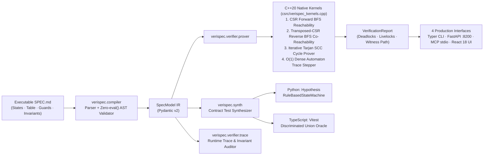

# VeriSpec-SDD (`v1.0.0`)

**Executable `SPEC.md` State-Machine Compiler, C++20 Finite-State Reachability / Deadlock / Livelock Prover & Hypothesis / TypeScript Property-Test Synthesizer (`CLI · FastAPI :8200 · MCP Server · React 18 Workbench`)**

[](https://github.com/nagarjunak-pixel/verispec-sdd/actions/workflows/ci.yml)
[](https://github.com/nagarjunak-pixel/verispec-sdd/releases/tag/v1.0.0)
[](https://github.com/nagarjunak-pixel/verispec-sdd)
[](LICENSE)

> **Executive Business Impact & Enterprise ROI (20-Second Scan)**
> - **Enterprise Failure Mode Eliminated:** Spec-Driven Development (`SPEC.md` workflows used with Claude Code, Cursor, and Copilot) treats Markdown specifications as prose—allowing AI coding agents to ship silent **order/payment deadlocks** (reachable states with no exit), **compliance livelock loops** (cycles with zero path to settlement/cancellation), **ambiguous unguarded transitions**, and **untested business invariants** into production.
> - **What `verispec-sdd` Delivers:** Compiles human-readable `SPEC.md` documents into a formal finite-state machine IR, proves **reachability, deadlock freedom, livelock freedom (transposed-CSR co-reachability + Tarjan SCC), and transition determinism in `0.16 ms`**, verifies live runtime execution traces against zero-`eval()` AST guards/postconditions/invariants, and auto-synthesizes runnable **Python (`Hypothesis` `RuleBasedStateMachine`)** and **TypeScript (`Vitest`)** contract test suites.
> - **Measured Systems Proof (Apple Silicon / Clang `-O3 -std=c++20` & Ubuntu Python `3.13`):**
>   - **41.58x Native C++20 Kernel Speedup:** `0.063 ms` (C++20 CSR prover + trace stepper via zero-copy buffer protocol) vs `2.608 ms` (pure-Python reference twin) across a `2,000`-state, `7,996`-transition automaton + `25,000`-event execution trace.
>   - **End-to-End Enterprise Order-to-Cash Audit:** Catches `ON_HOLD` deadlock, `DISPUTED <-> UNDER_REVIEW` livelock trap, and `LEGACY_REFUNDED` orphan terminal in **`0.211 ms`**, and proves the governed `v1.0.0` workflow sound in **`0.161 ms`**.
>   - **Strict Engineering Hygiene:** `mypy --strict` (`0` errors), `ruff` (`0` warnings), **`98.01%` pytest branch coverage** (including Hypothesis property-based C++20/Python parity tests and live execution of synthesized state-machine tests), plus a **React 18 + TypeScript** visual workbench.

---

## 60-Second Quickstart

```bash
git clone https://github.com/nagarjunak-pixel/verispec-sdd.git
cd verispec-sdd
uv sync --python 3.13 --all-extras

# 1. Run buggy vs governed enterprise Order-to-Cash SPEC.md audit + C++20 benchmark
uv run verispec demo

# 2. Run C++20 CSR reachability, co-reachability, Tarjan SCC & trace benchmark
uv run verispec bench --states 2000 --trace-len 25000

# 3. Start FastAPI control plane (:8200) or stdio MCP server for Claude Code / Cursor
uv run verispec serve --port 8200
uv run verispec mcp
```

---

## Architecture & Component Flow



---

## Executable `SPEC.md` Format

`verispec-sdd` compiles clean Markdown tables that product managers, architects, and coding agents can read and review in pull requests:

```markdown
# Spec: GovernedEnterpriseOrderFlow
- **Version**: 1.0.0
- **Initial**: `CREATED`
- **Terminal**: `COMPLETED`, `CANCELLED`

## States
- `CREATED`: Order initialized [invariant: amount >= 0]
- `PAYMENT_AUTHORIZED`: Payment captured [invariant: paid == True]
- `RISK_HOLD`: High-risk order awaiting supervisor review
- `FULFILLED`: Warehouse shipment confirmed [invariant: paid == True]
- `COMPLETED`: Settlement finalized [invariant: paid == True]
- `CANCELLED`: Order cancelled or rejected

## Transitions
| From | Event | To | Guard | Postcondition |
| --- | --- | --- | --- | --- |
| CREATED | authorize_payment | PAYMENT_AUTHORIZED | amount > 0 and fraud_score < 80 | paid == True |
| CREATED | route_risk_hold | RISK_HOLD | fraud_score >= 80 | - |
| CREATED | cancel_order | CANCELLED | - | - |
| RISK_HOLD | approve_override | PAYMENT_AUTHORIZED | manual_override == True | paid == True |
| RISK_HOLD | reject_risk | CANCELLED | manual_override == False | - |
| PAYMENT_AUTHORIZED | confirm_shipment | FULFILLED | paid == True | - |
| PAYMENT_AUTHORIZED | cancel_order | CANCELLED | - | - |
| FULFILLED | finalize_settlement | COMPLETED | paid == True | - |

## Invariants
- `non_negative_amount`: `amount >= 0`
- `completed_requires_payment` [COMPLETED]: `paid == True`
```

---

## Systems Engineering Deep Dive

1. **Native C++20 CSR Automaton Kernels (`csrc/verispec_kernels.cpp`):**
   - `verispec_forward_reachability`: Shortest-hop BFS over Compressed Sparse Row (`row_ptr`, `col_idx`) adjacency arrays to isolate `UNREACHABLE_STATE`, `ORPHAN_TERMINAL`, and `UNREACHABLE_TRANSITION` defects.
   - `verispec_liveness_co_reachability`: Builds the transposed CSR graph in `O(V + E)` and runs multi-source reverse BFS from all terminal states simultaneously. Any forward-reachable non-terminal state with `out_degree > 0` and `hops_to_terminal == -1` is flagged as a **`LIVELOCK_TRAP`**—catching multi-node endless review/retry loops that naive out-degree deadlock checks miss.
   - `verispec_tarjan_scc_cycles`: Explicit heap-stack (non-recursive) Tarjan strongly connected component decomposition (`O(V + E)`), safe against call-stack overflow on deep state graphs, annotating every state with `(scc_id, in_cycle)`.
   - `verispec_verify_event_trace`: `O(|trace|)` flat transition-table automaton stepper invoked via Python `array('i')` zero-copy buffer pointers.
2. **Bit-Exact Pure-Python Fallback + Hypothesis Parity Suite (`tests/test_kernels.py`):**
   - Every C++20 kernel has a pure-Python reference twin tested across randomized directed multigraphs and malformed event traces via Hypothesis property-based tests.
3. **Zero-`eval()` Safe Predicate AST Engine (`src/verispec/compiler/expr.py`):**
   - Parses guards, postconditions, and state/global invariants with `ast.parse(..., mode="eval")` against a strict AST node whitelist—forbidding dunder access, attribute traversal, comprehensions, and arbitrary calls.
4. **4 Production Surfaces Out of the Box:**
   - **CLI (`verispec`):** `compile`, `verify`, `synth`, `check-trace`, `demo`, `bench`, `serve`, `mcp`
   - **FastAPI Control Plane (`:8200`):** `/health`, `/metrics` (Prometheus), `/api/v1/compile`, `/api/v1/verify`, `/api/v1/synth`, `/api/v1/check-trace`, `/api/v1/demo`, `/api/v1/bench`
   - **Model Context Protocol (`.mcp.json`):** `verispec_compile_spec`, `verispec_verify_spec`, `verispec_synthesize_tests`, `verispec_check_trace` over newline-delimited JSON-RPC 2.0 stdio
   - **Workbench UI (`ui/`):** React 18 + TypeScript + Vite side-by-side `SPEC.md` editor, C++20 reachability/SCC state table, and live Hypothesis/Vitest code viewer

---

## Measured Benchmarks

| Workload | Native C++20 (`-O3 -std=c++20`) | Pure-Python Reference | Speedup |
| --- | ---: | ---: | ---: |
| `2,000` states · `7,996` edges · `25,000` trace events (CSR BFS + Reverse BFS + Tarjan SCC + Trace Step) | **`0.063 ms`** | `2.608 ms` | **`41.58x`** |
| `UngovernedAgentOrderFlow` (`8` states, `7` guarded edges — catches deadlock + livelock + orphan) | **`0.211 ms`** (end-to-end compile + prove) | — | Deterministic |
| `GovernedEnterpriseOrderFlow` (`6` states, `8` guarded edges — `100%` sound) | **`0.161 ms`** (end-to-end compile + prove) | — | Deterministic |

---

## Scope Boundaries & Honest Engineering Tradeoffs

- **Finite-State Structural + Guarded Trace Verification (Not Unbounded SMT Theorem Proving):** `verispec-sdd` proves structural graph reachability, deadlock freedom, co-reachability livelock freedom, and syntactic guard collisions in `O(V + E)` without requiring an external Z3 solver binary. Checking semantic disjointness of arbitrary arithmetic guards (e.g., `x > 10` vs `x > 20` on the same `(state, event)` pair) is exercised dynamically by the synthesized Hypothesis `RuleBasedStateMachine` and runtime trace verifier rather than symbolic SMT solving.
- **Single-Automaton Contract Scope:** Each `SPEC.md` models one bounded domain lifecycle (e.g., Order-to-Cash, Loan Underwriting, Agent Tool Approval). Communicating concurrent automata product construction (`A × B`) is intentionally kept out of v1.0 to preserve sub-millisecond CI/MCP feedback loops.

---

## Verification & CI Quality Gates

```bash
uv run ruff format --check src tests
uv run ruff check src tests
uv run mypy src tests
uv run pytest --cov=verispec --cov-report=term-missing --cov-fail-under=95
cd ui && npm ci && npm run build
```

## Author & License

Engineered by **Nagarjuna Kamireddy** ([Website](https://nagarjunak-pixel.github.io) · [GitHub](https://github.com/nagarjunak-pixel) · [LinkedIn](https://www.linkedin.com/in/nagarjuna-kamireddy)). Released under the [MIT License](LICENSE).
